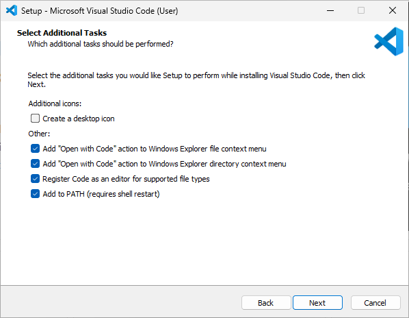

# Benodigdheden

Om deze module goed te kunnen volgen, heb je de volgende programma's nodig:

## Een browser

Een moderne webbrowser, zoals [Chrome](https://www.google.com/chrome/) (of een van de andere Chromium browsers, zoals [Edge](https://www.microsoft.com/edge), [Vivaldi](https://vivaldi.com/), [Opera](https://www.opera.com/) of [Brave](https://brave.com/)), [Firefox](https://www.mozilla.org/firefox/new/) of [Safari](https://www.apple.com/safari/). Internet Explorer of WebKit browsers anders dan Safari raden we af, omdat deze browsers niet altijd goed met moderne HTML en CSS versies overweg kunnen.

## Een editor: VS Code

Een editor met ondersteuning voor HTML en CSS. Daarvan zijn er een heleboel, maar wij raden *Visual Studio Code* aan.

Visual Studio Code kun je installeren vanaf [hun website](https://code.visualstudio.com/) en de installatie spreekt redelijk voor zich. De meeste standaard-opties zijn prima, maar het is aan te raden om ook de *Add 'Open with Code' action to Windows Explorer ...* opties aan te vinken.

Als VS Code opent, dan krijg je de vraag om in te loggen. Dat kun je doen, maar is niet nodig, dus voel je vrij om die popup weg te klikken.

### Extensie: Live Server

Met [*Live Server*](https://marketplace.visualstudio.com/items?itemName=ritwickdey.LiveServer) kun je vanuit Visual Studio Code jouw website direct in de browser openen. Als je aanpassingen maakt in de code, wordt je website automatisch ververst, zodat je direct het resultaat kunt zien.

Open het *Extensions* paneel in de linkerzijbalk (dat is die met vier blokjes, waarvan er eentje scheef staat) en zoek naar *Live Server* gemaakt door *Ritwick Dey*. Klik op *Install* bij die extensie en geef aan dat je de ontwikkelaar vertrouwt als daarom wordt gevraagd.

Als je een pagina van je website open hebt in VS Code, klik je rechtsonder op *Go Live* om de pagina te openen in je browser. Laat de pagina openstaan! Wijzigingen die je maakt in je code worden dan automatisch daar weergegeven. De *Go Live* knop veranderd daarna in een stop knop, waarmee je de server weert kunt stoppen.

### Extensie: W3C Web Validator

Met [*W3C Web Validator*](https://marketplace.visualstudio.com/items?itemName=CelianRiboulet.webvalidator) kun je makkelijk laten checken of je code voldoet aan de standaarden voor HTML en CSS.

Open het *Extensions* paneel in de linkerzijbalk (dat is die met vier blokjes, waarvan er eentje scheef staat) en zoek naar *W3C Web Validator* gemaakt door *Celian Riboulet*. Klik op *Install* bij die extensie en geef aan dat je de ontwikkelaar vertrouwt als daarom wordt gevraagd.
