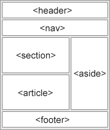
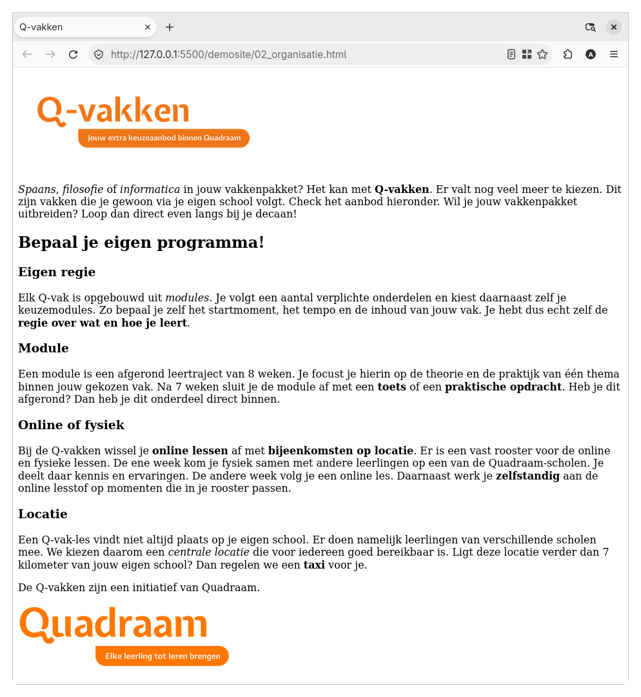

# Organisatie

Zoals je misschien al hebt gemerkt tijdens het lezen van de code in het voorbeeld is het niet op het eerste gezicht duidelijk hoe de website georganiseerd is. In HTML5 is hier een nieuw systeem voor geïntroduceerd, dit bestaat uit de zogenaamde **Semantic Elements**. Deze elements zorgen ervoor dat elke website in de basis op dezelfde manier gestructureerd kan worden zoals hiernaast. Door deze structuur kunnen computers en zoekmachines beter omgaan met de websites, waardoor de ervaring van de gebruiker verbeterd.



## H​eader

`<header></header>` wordt gebruikt om de kop van een website of sectie te weergeven. Er mogen meer headers in één website gebruikt worden op verschillende plekken. `header` moet altijd in de omringende 'container' geplaatst worden voor de sectie of de website.

Let op dat de `<header>`-tag iets anders is dan de `<head>`. Wat is het verschil ook alweer?

```html
<header>
    <h1>Website Titel</h1>
</header>
```

## Nav

`<nav></nav>` wordt gebruikt om de hoofdnavigatie van de website weer te geven. In dit element zet je alle knoppen naar andere delen van je website.

```html
<nav>
    <a href="index.html">Home</a>
    <a href="informatie.html">Informatie</a>
    <a href="contact.html">Contact</a>
</nav>
```


## Section

`<section></section>` wordt gebruikt om secties in de website uit elkaar te houden. Dit is inhoud die thematisch bij elkaar hoort. Een startpagina zou bijvoorbeeld kunnen worden verdeeld in secties voor de introductie, de inhoud en contactinformatie.

```html
<section>
    <h2>Nieuws</h2>
    <p>Vandaag is onze nieuwe website gelanceerd!</p>
</section>
```

## Article

`<article></article>` wordt gebruikt om onafhankelijke, op zichzelf staande inhoud van elkaar te scheiden. Op een blog kan bijvoorbeeld iedere blogpost een nieuw artikel zijn.

```html
<article>
    <h3>Blogpost titel</h3>
    <p>Dit is de inhoud van een blogpost.</p>
</article>
```

Je kan articles in sections zetten, maar dit kan ook andersom. Het artikel over een voetbalwedstrijd kan in de sportsectie zitten, maar kan tegelijkertijd ook verschillende secties bezitten over verschillende onderwerpen in de wedstrijd.

## Aside

`<aside></aside>` wordt gebruikt om wat inhoud naast de hoofdcontent te zetten. `aside` moet altijd een verband hebben met de inhoud eromheen.

```html
<aside>
    <h4>Meer lezen</h4>
    <ul>
        <li><a href="#">Link 1</a></li>
        <li><a href="#">Link 2</a></li>
    </ul>
</aside>
```

## F​ooter

`<footer></footer>` wordt gebruikt om de voettekst van een document of sectie aan te geven. `footer` wordt veel gebruikt om de schrijver van het document, copyright informatie, contactinformatie en dat soort informatie te geven.

```html
<footer>
    <p>© 2025 Jouw Naam</p>
</footer>
```

## Figure en figcaption

De `<figure></figure` en `<figcaption></figcaption>` worden gebruikt om een beschrijving toe te voegen bij een plaatje op de website. Dit gaat op de volgende manier:

``` html
<figure>
    
    <figcaption>Plaatje 1 - Plaatje</figcaption>
</figure>
```

:::{exercise}
Maak een kopie van de website die je in Oefening 1 hebt gemaakt.
	1.	Open de map van je project in VS Code: File → Open Folder… en kies de map Webdesign (of waar je je project hebt).
	2.	Maak een nieuwe map: Open de Explorer (linker zijbalk). Klik op New Folder en noem de map Opdracht_2.
	3.	Kopieer index.html: Klik in de Explorer op Opdracht_1/index.html, druk Ctrl+C (macOS: Cmd+C), selecteer Opdracht_2 en druk Ctrl+V (macOS: Cmd+V).
	4.	Open Opdracht_2/index.html en pas het bestand aan zodat het voldoet aan de standaardindeling met semantische elementen (header, nav, section, article, aside, footer). Laat het controleren door klasgenoten of de docent.
:::

Hier is een voorbeeld van een goede implementatie:



Zie je geen verschil met het screenshot uit de vorige paragraaf? Dat klopt! We hebben in de code hieronder alleen de organisatie aangepast, en niet de inhoud van de site zelf. Zonder extra stijlregels (waar we later mee aan de slag gaan) zie je van de semantic elements nog niets terug op je website!

``` html
<!DOCTYPE html>
<html lang="nl">

<head>
    <meta charset="utf-8" />
    <title>Q-vakken</title>
</head>

<body>
    <header>
        
    </header>
    <section>
        <p>
            <i>Spaans</i>, <i>filosofie</i> of <i>informatica</i> in jouw
            vakkenpakket? Het kan met <b>Q-vakken</b>. Er valt nog veel meer te
            kiezen. Dit zijn vakken die je gewoon via je eigen school volgt.
            Check het aanbod hieronder. Wil je jouw vakkenpakket uitbreiden?
            Loop dan direct even langs bij je decaan!
        </p>
    </section>
    <section>
        <h2>Bepaal je eigen programma!</h2>
        <article>
            <h3>Eigen regie</h3>
            <p>
                Elk Q-vak is opgebouwd uit <i>modules</i>. Je volgt een aantal
                verplichte onderdelen en kiest daarnaast zelf je keuzemodules.
                Zo bepaal je zelf het startmoment, het tempo en de inhoud van
                jouw vak. Je hebt dus echt zelf de <b>regie over wat en hoe je
                leert</b>.
            </p>
        </article>
        <article>
            <h3>Module</h3>
            <p>
                Een module is een afgerond leertraject van 8 weken. Je focust je
                hierin op de theorie en de praktijk van één thema binnen jouw
                gekozen vak. Na 7 weken sluit je de module af met een
                <b>toets</b> of een <b>praktische opdracht</b>. Heb je dit
                afgerond? Dan heb je dit onderdeel direct binnen.
            </p>
        </article>
        <article>
            <h3>Online of fysiek</h3>
            <p>
                Bij de Q-vakken wissel je <b>online lessen</b> af met
                <b>bijeenkomsten op locatie</b>. Er is een vast rooster voor de
                online en fysieke lessen. De ene week kom je fysiek samen met
                andere leerlingen op een van de Quadraam-scholen. Je deelt daar
                kennis en ervaringen. De andere week volg je een online les.
                Daarnaast werk je <b>zelfstandig</b> aan de online lesstof op
                momenten die in je rooster passen.
            </p>
        </article>
        <article>
            <h3>Locatie</h3>
            <p>
                Een Q-vak-les vindt niet altijd plaats op je eigen school. Er
                doen namelijk leerlingen van verschillende scholen mee. We
                kiezen daarom een <i>centrale locatie</i> die voor iedereen goed
                bereikbaar is. Ligt deze locatie verder dan 7 kilometer van jouw
                eigen school? Dan regelen we een <b>taxi</b> voor je.
            </p>
        </article>
    </section>
    <footer>
        <p>
            De Q-vakken zijn een initiatief van Quadraam.
        </p>
        
    </footer>
</body>

</html>
```

## Div en span

Voordat semantic elements de standaard werden werd er veel gewerkt met `<div></div>` en `<span></span>`. Deze elements worden gebruikt om andere elements te groeperen, net zoals de semantic elements doen. Er zit echter wel één groot verschil tussen de twee methoden. Dat verschil is dat bij semantic elements al is vastgesteld op welke manier elements gegroepeerd moeten worden, terwijl dat met `div` en `span` niet zo is.

`div` groepeert de elements bij elkaar en zet er een witregel onder en boven, op deze manier wordt een op zichzelf staand blok gemaakt. `span` groepeert de elements in-line bij elkaar, ze worden dus achter elkaar gezet.

Je kan en mag deze elements nog steeds gebruiken om andere elements te groeperen, maar wanneer je semantic elements kan gebruiken dan is het sneller en beter om deze te gebruiken.
